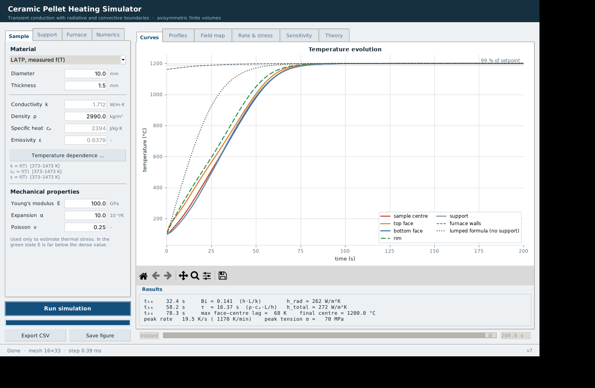

# Pellet heating simulator for fast firing

Transient heat transfer in a ceramic pellet dropped into a preheated furnace,
solved by axisymmetric finite volumes with radiation and convection on the
free surfaces.

The question it answers is the practical one behind fast firing. The furnace is
already at temperature; the pellet is not. **How long before its coldest point,
the centre, is actually hot enough to sinter?** Everything else the program
reports (heating rate, through-thickness gradient, thermal stress) follows from
the same solution.



## What it does

- Two-layer axisymmetric mesh: the pellet and the setter it rests on. The
  support usually dominates the heating time, so leaving it out is not an
  option.
- Radiation kept non-linear, as `ε·σ·(T⁴ − Te⁴)`. Linearising it costs tens of
  per cent early in the transient, which is exactly the part that matters here.
- Surface temperature solved at each exposed face instead of applying the flux
  at the cell-centre temperature. That one correction removes a 1.4 % bias.
- Temperature-dependent `k(T)`, `cₚ(T)` and `ε(T)`, entered as expressions or
  taken from the built-in measured data for LATP and alumina. With a varying
  `cₚ` the time advance runs on enthalpy, not temperature, so energy is
  conserved to machine precision.
- Thermal stress from the deviation of each point from the **mean** temperature
  of the piece, which is what actually drives it — not the face-to-centre
  difference, which overstates it by roughly a factor of two.
- A compact closed-form model alongside the full solution, for sanity checking.
- Sensitivity analysis: elasticities for every input plus sweeps over the full
  useful range of the important ones.

The full derivation, the validation and the limitations are in the **Theory**
tab inside the program, and in `report.pdf`.

## Installing

```bash
git clone https://github.com/EcerUnit/fast-firing-heating-simulator.git
cd fast-firing-heating-simulator
pip install -r requirements.txt
python heating_simulator.py
```

Python 3.9 or newer, plus numpy and matplotlib. Tkinter comes with Python on
Windows and macOS; on Debian or Ubuntu it is a separate package:

```bash
sudo apt install python3-tk
```

## Using it

Fill in the sample, support, furnace and numerics tabs on the left, then press
**Run simulation**. Results appear as curves, through-thickness profiles, a
field map, heating rate and stress.

Any property can be made a function of temperature through the **Temperature
dependence …** button. Expressions are written in `T`, in kelvin, with ordinary
Python syntax, and they are clamped outside the validity range you give them —
an extrapolated polynomial that goes negative would otherwise break the solve
without saying anything.

```
k   = -2.016e-17*T**6 + 1.278e-13*T**5 - ...     [373-1473 K]
cp  =  9.052e2 + 3.678e-1*T - 2.142e-3/T**2      [373-1473 K]
eps =  7.314e-4*T - 1.774e-1                     [373-1473 K]
```

**Compute sensitivity** on the Sensitivity tab ranks every input by its
elasticity on the heating time. It costs roughly 35 full simulations, so give
it a couple of minutes.

The solver can also be used without the interface:

```python
from heating_simulator import Model, t_fraction, K0, props_latp, props_alumina

p = dict(r_sample=0.005, e_sample=0.0015,
         sample=dict(rho=2990.0, **props_latp()),
         with_support=True, e_support=0.002, r_support=0.010,
         support=dict(rho=3900.0, **props_alumina()),
         R_contact=0.0, T_furnace=1200 + K0, T_initial=100 + K0,
         drop=40.0, tau_recovery=20.0, h_conv=10.0)

r = Model(p, 14).solve(200.0)
print(t_fraction(r["t"], r["T"][:, 0], 0.99, p["T_initial"], p["T_furnace"]))
```

`examples/headless_run.py` is the same thing, ready to run.

## How far to trust it

The numerics are checked, the physics has one real gap, and the two should not
be confused.

**Checked.** The solver reproduces the analytical series for an infinite slab
with a convective boundary to 0.005 % on the finest mesh. Mesh convergence is
second order — halving the spacing divides the error by four. With
temperature-dependent `cₚ` the accumulated energy matches the theoretical value
to 1.3·10⁻¹⁴ %.

**The main gap.** Radiative view factors are not modelled: every exposed face is
treated as seeing the whole furnace. The rim of a 10 mm × 1.5 mm pellet is 37 %
of its exposed area, and the setter shades part of its solid angle, so absolute
times for a supported pellet carry a real uncertainty from this. Relative
comparisons are much safer than absolute ones.

Also unmodelled: shrinkage during the transient (dimensions are held fixed),
any heat of transformation other than what an apparent `cₚ` already contains,
and the boundary condition under the support base.

## Layout

```
heating_simulator.py     GUI and solver, one file
sensitivity.py           elasticities and sweeps
report.pdf               full derivation, validation and references
examples/headless_run.py using the solver without the interface
docs/report.tex          LaTeX source of the report
docs/fig_*.pdf           its figures
docs/make_figures.py     regenerates the figures and numbers.json
docs/numbers.json        the values the report quotes, straight from the model
```

The report is written in Spanish; the program and this README are in English.

`docs/make_figures.py` is what keeps the report honest: every figure and every
number quoted in the text is produced by running the model, so the document
cannot drift away from the code. It needs scipy on top of the project's own
requirements, and it takes a while:

```bash
cd docs && PYTHONPATH=.. python make_figures.py && latexmk -pdf report.tex
```

`report.pdf` has to sit next to `heating_simulator.py` for the *Open full PDF
report …* button to find it. The Theory tab holds the same content either way.

`heating_simulator.py` and `sensitivity.py` must come from the same version;
the pair is checked at import and refuses to run mismatched.

## A note on the code

The parameter dictionary uses keys like `e_sample`, `with_support` and
`T_furnace`. They are the contract between the two files, so renaming one
without renaming the other breaks the solver. The full list, with units, is at
the top of `sensitivity.py`.

## Citing

See `CITATION.cff`. The report is the thing to cite for the model itself.

## Licence

MIT. See `LICENSE`.
